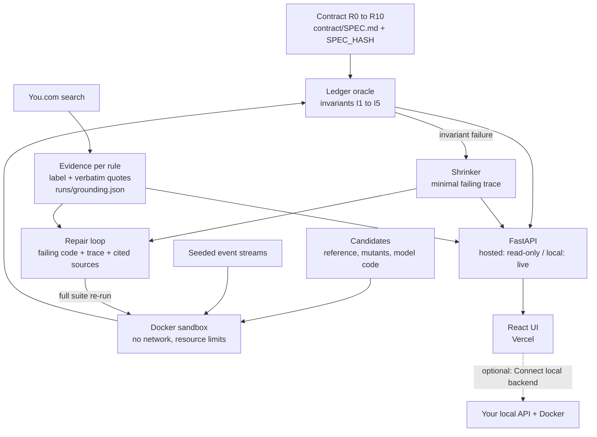

# 🧾 PaySift

### Invariant Testing & Counter example Shrinking for AI-Written Payment Webhook Handlers — Sandboxed, Evidence-Grounded, Honest About Its Limits

[](https://pay-sift.vercel.app)
[](https://paysift-api.onrender.com/health)
[](https://github.com/nikhil-0420/Pay-Sift)
[](https://www.python.org/)
[](https://fastapi.tiangolo.com/)
[](https://react.dev/)
[](https://www.docker.com/)
[](https://you.com/platform)

[**Live Site**](https://pay-sift.vercel.app) · [**API Health**](https://paysift-api.onrender.com/health) · [**API Docs**](https://paysift-api.onrender.com/docs) · [**Repo**](https://github.com/nikhil-0420/Pay-Sift)

> ⚠️ **Honest framing, up front:** PaySift is a research and portfolio prototype, not a benchmark and not a product. The harness is validated against bugs we wrote ourselves. The one model finding it reports is a single candidate, under a single prompt condition, against a single rule. Evidence from You.com is mostly partial or absent, and we say so on every screen. Nothing here is a leaderboard, and nothing is a claim that any model is good or bad at payments.

---

## 📌 Overview

AI code generators write payment webhook handlers that look right: clean JSON, typed Python, sensible status codes, tests that pass. The failures only show up when deliveries get awkward: retries, out-of-order events, duplicates, restarts, concurrent refunds.

PaySift is a harness that makes those failures visible and small:

- A written **contract** (rules R0 to R10) defines what a correct handler must do
- A deterministic **ledger oracle** checks five invariants (I1 to I5) after every delivery
- Candidate handlers (a reference, hand-written mutants and model-generated code) run in a **Docker sandbox** with no network
- When an invariant fails, a **shrinker** reduces the event stream to the smallest recorded sequence that still breaks the ledger
- A **You.com evidence layer** retrieves public documentation for each rule and labels how well it supports the rule (and says so plainly when it does not)
- A **repair loop** can ask a model to fix the failing handler, and a fix only counts if the full suite passes again

I1 to I4 are the financial invariants (signature, idempotency, conservation, bounds). I5 is the interface invariant. They are always shown separately.

---

## 🖥️ What's in the app

- **Findings** — a run explorer: every recorded run with source, model, condition, failures, minimal trace length and classification. Alphabetical by default, never ranked
- **Kill matrix** — the reference handler and every mutant against every invariant, with the intended invariant outlined
- **Break it** — a library of payment scenarios replayed against the reference and the mutants
- **Pilot** — model candidate outcomes, Condition A kept separate from the illustrative Condition B
- **Repair** — the repair loop: failure, prompt, fix, full-suite re-run, verdict
- **Spec** — rules R0 to R10, each with its evidence panel, plus a "Spec gaps" tab of open questions
- **Method** — the evidence pipeline from contract to counterexample

| Part | Where it runs | What it can do |
|---|---|---|
| **Frontend** | Vercel (static) | Everything above, from bundled data |
| **Hosted API** | Render, read-only | Recorded runs, kill matrix, cached evidence, live You.com search (rate-limited) |
| **Local backend** | Your machine, with Docker | Live sandbox runs and live model repair, using your own keys |

The hosted API never executes candidate code and never calls a model. See [Run it locally](#-run-it-locally-with-docker).

---

## ✨ Features

| Feature | Description |
| --- | --- |
| 🧪 **Deterministic oracle** | A SQLite ledger oracle evaluates five invariants after each delivery. Results are reproducible across seeds |
| 🔒 **Sandboxed execution** | Untrusted handler code runs in a Docker container with no network and resource limits. Seven hostile handlers are in the test suite to prove containment |
| ✂️ **Counterexample shrinking** | Failing streams are reduced to a minimal event sequence that still fails, so a human can read it |
| 📚 **Evidence per rule** | Each rule gets a You.com retrieval, an LLM-judged label (supported, partial, not found, conflict) and verbatim quotes checked as exact substrings of the retrieved snippet |
| 🧑‍⚖️ **Human overrides, visible** | Where a person changed an LLM label, the UI shows it as human-reviewed. Everything else is shown as LLM-judged and unreviewed |
| 🛠️ **Grounded repair** | A repair request carries the failing code, the minimal trace and the cited sources, and is accepted only after a full-suite re-run |
| 🏷️ **Provenance on everything** | Hand-written mutants are always labelled as such. A mutant is never presented as model output |
| 🌐 **Honest hosting** | The hosted site falls back to a bundled static snapshot when the free-tier API is asleep, and says so in a banner |
| 🧭 **Connect local backend** | The hosted UI can attach to your own local backend to unlock live runs and repair |

---

## 🏗️ Tech Stack

**Harness**
- Python 3.12 · SQLite ledger oracle · seeded event-stream generation · delta-debugging style shrinker
- Docker sandbox (`runner/`) — no network, memory/CPU/process limits, hostile-handler tests

**Evidence layer**
- You.com Search API — retrieval and cache (`grounding/`)
- An LLM judge for support labels, with human overrides (`grounding/overrides.yaml`)

**Backend**
- FastAPI · Uvicorn — read-only hosted mode and full local mode

**Frontend**
- React + TypeScript + Vite · Vitest — self-hosted fonts, no CDN, no remote images

**Hosting**
- Vercel (static frontend) · Render (read-only API)

---

## 📐 Architecture



---

## 📊 What's actually been verified

**The harness, on hand-written bugs (validation, not a model result):**
- The **reference handler** records no failures against I1 to I5 in the kill matrix
- The kill matrix reports **13 of 13 mutants killed**: nine hand-written (M1 to M9) and four extra (X1 to X4). None of them is model output
- For M7 to M9 (restart and concurrency defects) the matrix shows intended-invariant markers rather than per-invariant failure counts
- The kill matrix is **partly circular and self-attested**: we wrote the mutants and the checks, so it validates that the oracle can see these bugs, not that it can see all bugs

**The sandbox:**
- Seven hostile handlers (`tests/hostile/`) are contained, with no leftover containers
- The reference handler and the mutants produce the same results in the sandbox as in direct execution across the parity seed ranges we ran

**The specification review (Gate 1):**
- Before candidate generation, the contract was reviewed by two independent predictors, **Koushik** and **Rithvik**, who each filled the answer sheet for ten fresh cases without opening the answer key
- Outcome: **passed, with no disagreements and no spec change**. The spec hash stayed `289fa48f542ffcf36eb6f27ba4fd513c97312f8c987396b8a2e98e1cdaea230a`
- The spec is still labelled `DRAFT-FROZEN`, and ten open spec questions are kept in [`docs/SPEC_GAP_LIST.md`](docs/SPEC_GAP_LIST.md)

**Automated tests:** `pytest -q`, `python cli.py selftest` and `npm run verify` (typecheck, Vitest, contract check, build) are the checks we run before every release.

---

## 🔎 The real model finding

| | |
|---|---|
| **Candidate** | `strong_a/A/3` (`candidates/strong_a/A/3.py`) |
| **Model** | `gemini-3.5-flash-lite` |
| **Condition** | **A** — full contract prompt, rules R0 to R10 printed verbatim (not the illustrative Condition B) |
| **Rule broken** | **R8, Rejection Non-Consumption** (invariant `I2_idempotency`) |
| **Classification** | (a), rule violated as written. Confirmed by human review of the diagnostic packet |
| **Minimal trace** | 4 events, reproduced 10 out of 10 times across runs |

> *R8:* "A 'rejected' event produces no state change and does NOT consume its event_id. If the same event_id is redelivered later with valid parameters or prerequisites satisfied, it must be processed and applied normally."

**Mechanism.** The handler wrote every incoming event id into an auxiliary `processed_events` table, including events it rejected. When the prerequisite capture arrived later and the refund was redelivered, the handler treated the refund as a duplicate instead of applying it.

**Scope, stated plainly:**
- 15 candidates were generated across 2 usable models (Gemini 3.5 Flash Lite and a Qwen model on Groq). A third provider produced none because of free-tier rate limits
- This finding is one candidate under one condition. It says nothing about how often these models fail, and PaySift does not rank models
- Other recorded failures exist in the Pilot page (for example `strong_b/A/2` shows I1 signature failures with a zero-event minimal trace). Only `strong_a/A/3` went through human classification and was chosen as the featured finding

Full details: [`pilot/DECISION.md`](pilot/DECISION.md).

---

## 📚 Evidence grounding (You.com)

Each rule is searched against public provider documentation, and an LLM judge labels how well the retrieved sources support it. Every quote shown must be an exact substring of the retrieved snippet and stay within the word limit.

| Label | Rules | How it was set |
|---|---|---|
| **Supported** | R1 | LLM-judged, unreviewed |
| **Partial** | R3, R6 | LLM-judged, unreviewed |
| **Partial** | R8, R9, R10 | Changed from supported to partial by a human override |
| **Not found** | R0, R2, R4, R5, R7 | LLM-judged; no support found, shown as "PaySift convention" |

**Human override reasons (as recorded in `grounding/overrides.yaml`):**
- **R8:** the quote is about API idempotency keys, not webhook event ids, so it supports the concept only
- **R9:** the source only says SQLite survives crashes and does not cover idempotency across restarts
- **R10:** the only source is a blog post, not official provider documentation

"Supported by sources" never means "the spec is verified". It means the retrieved documentation is consistent with the rule as written.

---

## 🛠️ Grounded repair

The repair loop sends a model the failing candidate, the minimal trace and the cited sources, then re-runs the **full** invariant suite on the proposed fix. A repair that fixes the target rule but breaks another invariant is recorded as a failure.

<!-- REPAIR_RESULT: replace the line below with the exact values from repair/cache and handoff/N8_REPAIR_DONE before publishing -->
- **Status for `strong_a/A/3` (R8):** see the Repair page of the live site and [`repair/cache/`](repair/cache/). The README does not restate numbers that the cached artifact already records

---

## 🚀 Run it locally with Docker

The hosted site is **read-only**. Live runs execute untrusted, model-written Python and need a container sandbox, and live repair needs your own model keys, so neither can safely run on the public API.

### Prerequisites
- Python 3.12
- Node.js 18+
- Docker Desktop (WSL2 backend on Windows) or Docker Engine on Linux/macOS
- Your own model keys (see `.env.example`) for repair; a You.com key for evidence search

### 1. Automated setup
```powershell
git clone https://github.com/nikhil-0420/Pay-Sift.git
cd Pay-Sift
.\scripts\setup_local.ps1
```
Linux / macOS:
```bash
git clone https://github.com/nikhil-0420/Pay-Sift.git
cd Pay-Sift
./scripts/setup_local.sh
```
The script checks Docker, builds the sandbox image, creates a virtual environment, installs dependencies, copies `.env.example` to `.env` if it is missing, and runs the self-test.

### 2. Add your keys
Open `.env` and fill in the variables listed in `.env.example`. Never commit this file.

### 3. Start the API and the UI
```bash
# terminal 1
python cli.py serve
```
```bash
# terminal 2
cd ui
npm install
npm run dev
```
The API listens on `http://127.0.0.1:8000` and the UI on `http://localhost:5173`.

### 4. Or connect the hosted UI to your local backend
On the **Break it** or **Repair** page of the live site, use **Connect local backend**, enter `http://127.0.0.1:8000` and connect. Live runs and repair unlock when the backend reports a working sandbox.

Some browsers block an https page from calling `http://localhost` (Safari, and some Chrome and Edge configurations). If that happens, run the UI locally with `npm run dev` instead.

### Tests
```bash
pytest -q
python cli.py selftest
python cli.py demo
cd ui && npm run verify
```

---

## 📂 Project Structure

```text
Pay-Sift/
├── api/                    # FastAPI service: runs, kill matrix, evidence, break, repair (hosted read-only mode + local mode)
├── candidates/             # Model-generated handlers and generation summary
├── config/                 # models.yaml (model ids; no keys)
├── contract/               # SPEC.md, SPEC_HASH, schema, run schema, Gate 1 packet
├── docs/                   # DEPLOY.md, API_CONTRACT.md, SPEC_GAP_LIST.md, EVIDENCE_REVIEW.md, PITCH_READINESS.md
│   └── process/            # The stage prompts used to build the project
├── grounding/              # You.com retrieval, cache, judge and human overrides
├── handoff/                # Stage markers used for coordination between builders
├── mutants/                # Hand-written (M1 to M9) and extra (X1 to X4) buggy handlers
├── oracle/                 # Ledger oracle and invariant checks
├── pilot/                  # Pilot report, review sheet, diagnostic packets, DECISION.md
├── repair/                 # Repair loop, prompt builder and cached repair results
├── runner/                 # Docker sandbox runner and Dockerfile
├── runs/                   # Recorded run JSON and grounding.json
├── scripts/                # Local setup scripts
├── tests/                  # Python tests, including tests/hostile
├── ui/                     # React + TypeScript frontend (Vite, Vitest)
├── cli.py                  # serve, selftest, demo, generate, pilot, repair
├── render.yaml             # Render service definition (hosted read-only API)
└── requirements.txt
```

---

## 🔬 Methodology Highlights

1. **Counterexamples, not opinions** — a failure is a short, replayable event sequence and a ledger that disagrees with the contract
2. **The validator is validated first** — the oracle is tested on known-bad handlers before any model code is judged
3. **Financial and interface invariants stay separate** — I1 to I4 and I5 are reported apart so a crash cannot hide a money bug
4. **Evidence is labelled, never inflated** — every rule shows what the sources do and do not say, and rules with no support are marked as PaySift conventions
5. **Humans decide what counts** — failures are classified by people, and label overrides are shown as human-reviewed
6. **Repairs must pass the whole suite** — fixing one rule while breaking another is a failed repair
7. **No ranking** — outcomes are listed alphabetically and never turned into a leaderboard

---

## 🔮 Known Limitations

- The mutants and the oracle were written by the same team, so the kill matrix is partly circular and self-attested
- One real finding, one candidate, one condition, one rule. The sample is a diagnostic exercise, not a comparison of models
- Only two providers produced usable candidates; a third was blocked by free-tier rate limits
- Most evidence labels are LLM-judged and unreviewed. Only R8, R9 and R10 have human overrides, and no rule has full provider-documentation support except R1
- Ten open spec questions remain, and the contract is frozen rather than finalised
- The hosted API runs on a free tier that sleeps when idle, so the first request can take about a minute. The site falls back to a static snapshot and says so
- Live sandbox runs and live repair are available only locally, with your own Docker and keys
- Some recorded failures (for example a zero-event minimal trace on `strong_b/A/2`) have not been human-classified

---

## 👥 Team

Built for the **BEYOND 9TO5** buildathon (EtriqAI Developers, Bengaluru, 21 November 2026), Track 2 (You.com), and completed afterwards.

| Member | Area |
|---|---|
| **Nikhil** ([GitHub](https://github.com/nikhil-0420)) | You.com evidence layer, frontend, hosting (Render and Vercel), readiness audits, README |
| **Nehaa** | Docker sandbox, API contract, model configuration, candidate generation, pilot, repair loop |

---

**⭐ If you found this project interesting, consider giving it a star.**
