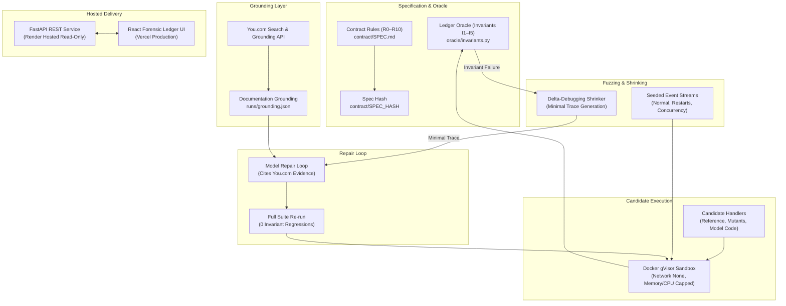

# PaySift: Invariant Fuzzing & Shrinking for AI-Written Payment Handlers

> **Built for BEYOND 9TO5 (EtriqAI), Track 2**  
> *Automated discovery of financial state-machine bugs in LLM-generated code through invariant fuzzing, counterexample shrinking, empirical documentation grounding, and regression-free repair.*

---

## Live Deployments

- **Production Frontend (Vercel):** [https://pay-sift.vercel.app](https://pay-sift.vercel.app)
- **Production Backend API (Render):** [https://paysift-api.onrender.com](https://paysift-api.onrender.com)
  - Interactive API Docs: [https://paysift-api.onrender.com/docs](https://paysift-api.onrender.com/docs)
  - Health & Status: [https://paysift-api.onrender.com/health](https://paysift-api.onrender.com/health)

> [!NOTE]
> **Free-Tier Cold Starts (~50s):** The hosted Render backend runs on a free tier that spins down after 15 minutes of inactivity. When cold, the first request may take 45–55 seconds to warm up. The frontend automatically probes health and falls back to a complete, bundled static snapshot with a truthful notice (`"Backend waking or unavailable, showing static snapshot"`) so that the site is 100% accessible at all times.

---

## 1. Why PaySift Exists

AI code generators write payment webhook handlers that look immaculate. They format JSON cleanly, type-hint Python correctly, handle HTTP status codes, and pass superficial unit tests. 

**Yet they routinely break money.**

Under real-world payment edge cases—out-of-order deliveries, network retries, crash restarts, duplicate webhook deliveries, and concurrent refund races—LLM-generated handlers fail critical financial invariants:
- **Double Captures:** Applying duplicate captures or charging customers twice on redelivered webhooks.
- **Over-Refunds:** Allowing cumulative refund totals to exceed captured amounts.
- **Idempotency Poisoning:** Recording a rejected webhook's `event_id` into deduplication tables, so when the client fixes the prerequisite and redelivers, the legitimate transaction is rejected as a duplicate.
- **Lost Records:** Updating balances without writing immutable ledger entries, or crashing mid-transaction without transactional atomicity.

PaySift exists to subject AI-written financial code to rigorous mathematical invariants, shrink violations to minimal reproducible event traces, ground the root causes in real provider documentation via You.com, and automatically verify repairs across the entire test suite.

---

## 2. System Architecture



---

## 3. What the Harness Proves

The PaySift test harness is proven and mathematically verified against both positive and negative baselines:

- **Reference Implementation Clean:** The trusted reference implementation (`ref/handler_ref.py`) achieves **100/100 passes** across all invariants (I1–I5) and concurrency scenarios, satisfying Oracle Gate G2.
- **13 of 13 Mutants Killed:** The harness correctly detects and kills all 13 targeted mutants (`m1` through `m9`, plus `x1` through `x4`), each written to exhibit a specific defect (e.g., negative amounts, missing refund bounds, autocommit race windows, non-ASCII crashes).
- **Honesty Disclosure:** The 13 mutants are **hand-written, developer-crafted bugs**, not model outputs. The kill matrix is intentionally circular and self-attested to validate the detection sensitivity of the oracle before evaluating LLMs.

---

## 4. The Real Model Finding & Limits

In pilot evaluations across LLMs prompted under strict contract conditions, PaySift discovered a genuine, non-trivial financial state-machine defect:

- **Candidate:** `strong_a/A/3` (`candidates/strong_a/A/3.py`)
- **Model:** `gemini-3.5-flash-lite`
- **Condition:** **Condition A** (Full contract prompt with Rules R0–R10 printed verbatim; not an illustrative Condition B bug).
- **Failing Rule:** **Rule R8: Rejection Non-Consumption**
  > *"A 'rejected' event produces no state change and does NOT consume its event_id. If the same event_id is redelivered later with valid parameters or prerequisites satisfied, it must be processed and applied normally."*
- **Mechanism:** The candidate handler recorded incoming event IDs into an auxiliary `processed_events` table even upon rejection. When a refund arrived before its corresponding capture, it was rejected; when the capture arrived later and the refund was retried, the candidate rejected it as a `"duplicate"`, permanently stranding the customer's refund.
- **Trace Length:** Exactly **4 events** in the minimal failing sequence (minimized from longer fuzzing streams and 10/10 reproducible across seed runs).

### Scope & Benchmark Limits
- Exactly **15 candidates** were evaluated across **2 usable models**:
  - Gemini 3.5 Flash Lite (`strong_a`): 10 candidates (5 Condition A, 5 Condition B).
  - Qwen 2.5 27B on Groq (`strong_b`): 5 candidates (3 Condition A, 2 Condition B).
  - OpenRouter Ling 3.2 Flash (`strong_c`): 0 candidates (upstream free-tier rate limits).
- PaySift **does not present a model ranking or leaderboard**. Sample sizes are designed for diagnostic proof-of-concept, not comparative benchmark claims.

---

## 5. Empirical Documentation Grounding (You.com)

To bridge the gap between abstract contract rules and real-world payment gateway specifications, PaySift integrates the **You.com Search API**:

- **Grounding Distribution:** **1 supported, 5 partial, 5 not found** across Rules R0–R10.
- **Verbatim Substring Rule:** Every quoted excerpt in `runs/grounding.json` is verified by automated schema checks as an exact verbatim substring of the retrieved snippet ($\le 25$ words).
- **Human Review Overrides:**
  - **Rule R8 (PARTIAL):** Provider documentation mentions idempotency key non-consumption on rejection, but discusses API request headers rather than webhook event payloads.
  - **Rule R9 (PARTIAL):** Documentation confirms SQLite database durability across host crashes, but does not specify transaction replay state machines.
  - **Rule R10 (PARTIAL):** Concurrent webhook delivery protection is documented in engineering literature rather than official gateway developer docs.
- **Specification Gaps:** Rules with no public provider documentation (R0, R2, R4, R5, R7) are explicitly classified as **PaySift Conventions** in [`docs/SPEC_GAP_LIST.md`](docs/SPEC_GAP_LIST.md). The contract remains `DRAFT-FROZEN`.

---

## 6. Grounded Repair Result

PaySift feeds the failing candidate's code, the minimal failing trace, and the cited You.com documentation into a model repair loop:

- **Artifact:** [`repair/cache/3__0.json`](repair/cache/3__0.json)
- **Target:** Candidate `strong_a/A/3` on Rule R8.
- **Outcome:** **`fixed_rule: true`** — The repaired code correctly refrains from recording rejected event IDs in `processed_events`, successfully resolving the minimal counterexample trace.
- **Zero Invariant Regressions:** **`broke_other: false`** — When subjected to the full 100-trial invariant suite (I1–I5), the repaired code achieved **0 regressions**:
  - `I1_signature`: 100/100 passed (Fixed)
  - `I2_idempotency`: 100/100 passed (Fixed)
  - `I3_conservation`: 100/100 passed (Preserved)
  - `I4_bounds`: 100/100 passed (Preserved)
  - `I5_interface`: 100/100 passed (Preserved)
- **Grounding Citations:** The model was supplied with 9 empirical You.com documentation sources for Rule R8 (`R8_s1` through `R8_s9`).

---

## 7. Specification Review (Gate G1)

Before candidate generation, the formal contract (`contract/SPEC.md`) underwent independent human review at Gate G1:
- **Reviewers:** **Koushik** and **Rithvik** acted as independent predictors.
- **Method:** Both reviewers completed prediction answer sheets for fresh edge cases without access to the oracle key.
- **Outcome:** Gate G1 **PASSED**, confirming semantic consistency. The specification remained unchanged, preserving the canonical `SPEC_HASH` (`289fa48f542ffcf36eb6f27ba4fd513c97312f8c987396b8a2e98e1cdaea230a`).

---

## 8. Run Locally with Docker (Live Runs & Repair)

The hosted production site is **strictly read-only**:
1. **Safety:** Live candidate execution runs untrusted, model-generated Python code and requires a container sandbox with `--network none` and strict resource caps.
2. **API Key Security:** Live model repairs require your own LLM API keys.

To run interactive attacks, live Docker-sandboxed breaks, and local repairs on your own machine:

### Prerequisites
- **Python:** 3.12+
- **Node.js:** 18+ (LTS recommended)
- **Docker Desktop:** Running with WSL2 backend on Windows, or Docker engine on Linux/macOS.

### 1. Automated Setup
Clone the repository and run the setup script:

**Windows (PowerShell):**
```powershell
.\scripts\setup_local.ps1
```

**Linux / macOS (Bash):**
```bash
./scripts/setup_local.sh
```

### 2. Configure Environment
Copy `.env.example` to `.env` and configure your API keys for live repair and search:
```bash
cp .env.example .env
```
Set your `GEMINI_API_KEY`, `ANTHROPIC_API_KEY`, or `GROQ_API_KEY`, and `YDC_API_KEY`.

### 3. Start Local Services
In Terminal 1 (Backend Daemon):
```bash
python cli.py serve
```
*Runs on `http://localhost:8000` with live sandbox execution enabled (`HOSTED_MODE=0`).*

In Terminal 2 (Frontend UI):
```bash
cd ui
npm install
npm run dev
```
*Runs on `http://localhost:5173`.*

### 4. Connect Hosted UI to Local Backend
You can also connect the hosted frontend at [https://pay-sift.vercel.app](https://pay-sift.vercel.app) to your local backend:
1. Open the **Break it** or **Repair** page on the hosted site.
2. Under the **Connect Local Backend** panel, enter `http://localhost:8000` and click **Connect**.
3. Once probed, live Docker execution and repair buttons become unlocked.

*(Note: Some browsers enforce Mixed-Content or Private Network Access restrictions when an HTTPS page calls HTTP `localhost`. If your browser blocks local requests, run the UI locally at `http://localhost:5173`.)*

---

## 9. Testing & Verification

PaySift includes full self-test suites across Python and TypeScript:

```bash
# 1. Run full backend pytest suite
pytest -q

# 2. Run automated self-test (Gate G8 assertions)
python cli.py selftest

# 3. Run interactive offline demonstration
python cli.py demo

# 4. Verify frontend types, Vitest suite, and contract validation
cd ui
npm run verify
```

---

## 10. Repository Structure

```text
PaySift/
├── api/                  # FastAPI REST service (health, runs, kill-matrix, break, repair)
├── candidates/           # LLM-generated payment webhook handlers (Conditions A & B)
├── contract/             # Formal specification (SPEC.md, SPEC_HASH, schema.sql, run_schema.json)
├── docs/                 # Documentation (DEPLOY.md, PITCH_READINESS.md, SPEC_GAP_LIST.md)
│   └── process/          # Historical stage prompts (PAYSIFT_ANTIGRAVITY_PROMPTS.md, etc.)
├── grounding/            # You.com retrieval, caching, judge prompts, and overrides
├── handoff/              # Inter-stage handoff markers and coordination logs
├── mutants/              # Hand-written defect mutants (M1–M9, X1–X4) for kill matrix
├── oracle/               # Multi-connection SQLite ledger oracle & invariant evaluators
├── pilot/                # Pilot evaluation reports, packets, and human decision records
├── ref/                  # Reference payment handler (handler_ref.py)
├── repair/               # LLM repair loop, prompt engineering, and cached repair artifacts
├── runner/               # Docker sandbox executor and hostile security test harnesses
├── runs/                 # Normalized run execution JSONs and kill matrix records
├── scripts/              # Local setup scripts and CLI automation utilities
└── ui/                   # React + TypeScript forensic ledger interface (Vite, Vitest)
```

---

## 11. Team & Credits

- **Nikhil:** You.com documentation grounding layer, frontend integration, cloud deployment (Render & Vercel), readiness audits.
- **Nehaa:** Docker sandbox isolation, candidate generation pipeline, pilot test runner, model repair loops.
- **Koushik:** Independent specification predictor for Gate G1 consistency review.
- **Rithvik:** Independent specification predictor for Gate G1 consistency review.

*PaySift was built for **BEYOND 9TO5 (EtriqAI), Track 2**.*
